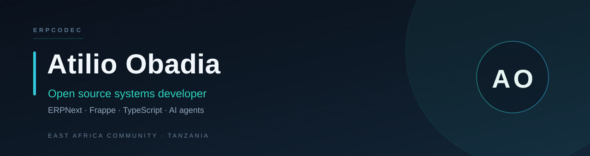

  

  Software developer at <b>Alpha Associates Tanzania Limited</b> &middot; building under the <b>ERPcodec</b> brand 
  Open to ERPNext, Frappe and systems integration work across East Africa.

  
  
  
  

## About

I build and run business systems: ERPNext and Frappe implementations, custom web platforms,
integrations between tools that were never meant to talk to each other, and the infrastructure
underneath them. I work with organisations in Tanzania and the wider East Africa Community,
mostly where paper and spreadsheets have stopped keeping up with the operation.

My background is on the infrastructure side — servers, networks, biometric attendance — which is
why I care less about demos and more about what happens at 08:00 on a Monday. The goal is always
the same: fewer spreadsheets, cleaner ledgers, records that survive an audit.

## What I do

- **ERP implementation** — full-cycle ERPNext and Frappe rollouts: chart of accounts design,
  workflows, custom DocTypes, server and client scripts.
- **Custom systems** — purpose-built platforms when off-the-shelf stops fitting: inventory,
  portals, booking, dashboards.
- **Systems integration** — REST APIs, payment and messaging gateways, third-party platforms,
  AI and MCP tooling.
- **Infrastructure** — server deployment and hardening, DNS and hosting, backups and monitoring,
  networking, biometric devices.

## Selected work

**[AIMSCAMS](https://github.com/atilioobadia-cpu/aimscams)** — back office for Tanzanian SACCOs and
microfinance institutions: members, savings, credit, teller operations, double-entry ledger and
regulatory returns.  
`TypeScript` `Next.js` `NestJS` `PostgreSQL`

**[csf_tanzania_v16](https://github.com/atilioobadia-cpu/csf_tanzania_v16)** — Tanzania localisation
for Frappe and ERPNext v16, covering tax, statutory and country-specific accounting behaviour.  
`Python` `Frappe`

**[warehouse_management](https://github.com/atilioobadia-cpu/warehouse_management)** — warehouse
management system built on Frappe for X Electronics: stock, movements and locations.  
`Python` `Frappe`

**[assignment_v16](https://github.com/atilioobadia-cpu/assignment_v16)** — production-ready custom
app configuration and DocType schemas for Frappe v16.  
`Python` `Frappe`

**[erpnext_payroll_dashboard](https://github.com/atilioobadia-cpu/erpnext_payroll_dashboard)** —
payroll dashboard for ERPNext: salary components, runs and settlement in one view.  
`Python` `Frappe`

**[AIMS_Ai_Agent](https://github.com/atilioobadia-cpu/AIMS_Ai_Agent)** — LLM-powered assistant for
the AIMS ecosystem, embedded where the work already happens.  
`TypeScript` `AI agents`

More projects: [`docs/PROJECTS.md`](docs/PROJECTS.md) &middot; domains: [`docs/DOMAINS.md`](docs/DOMAINS.md)

## Toolkit

**Languages**  

**Platforms**  

**Data and infrastructure**  

## GitHub activity

  <picture>
    <source media="(prefers-color-scheme: dark)" srcset="https://github-profile-summary-cards.vercel.app/api/cards/profile-details?username=atilioobadia-cpu&theme=github_dark" />
    
  </picture>

  <picture>
    <source media="(prefers-color-scheme: dark)" srcset="https://streak-stats.demolab.com?user=atilioobadia-cpu&theme=github-dark&hide_border=true" />
    
  </picture>

## Now

- Building **AIMSCAMS**, a specification-first back office for Tanzanian SACCOs and microfinance institutions.
- Working through **Tanzania localisation** for ERPNext and Frappe v16.
- Exploring **AI agents and MCP servers** that sit inside ERP workflows instead of beside them.

## Connect

[atilioobadia@gmail.com](mailto:atilioobadia@gmail.com) &middot;
[LinkedIn](https://www.linkedin.com/in/eng-atilio-obadia) &middot;
[Portfolio](https://atilioobadia-cpu.github.io/profile_personel/) &middot;
[+255 773 500 811](tel:+255773500811)

East Africa Community &middot; Tanzania. Available for ERPNext implementation, custom systems and
integration work. Collaboration notes are in [`docs/COLLAB.md`](docs/COLLAB.md), contribution
guidelines in [`CONTRIBUTING.md`](CONTRIBUTING.md), and vulnerabilities go through
[`SECURITY.md`](SECURITY.md).

  MIT licensed &middot; built and maintained in Tanzania

