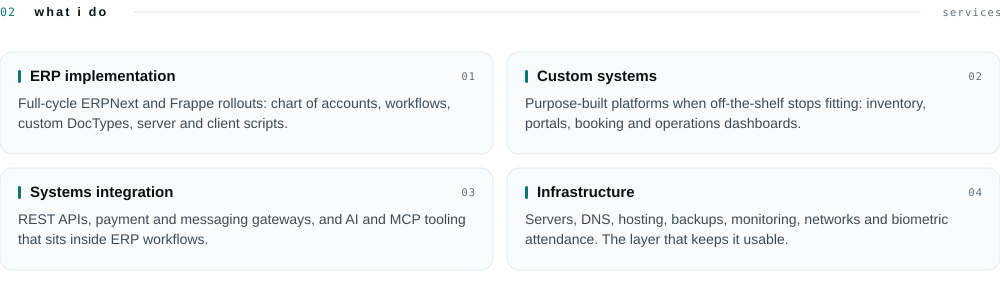
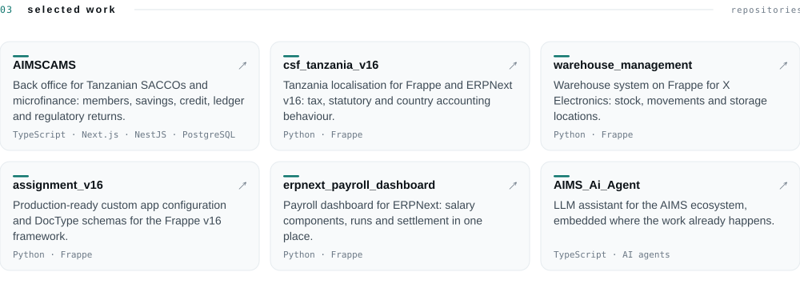
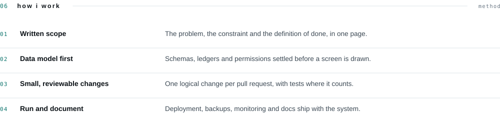
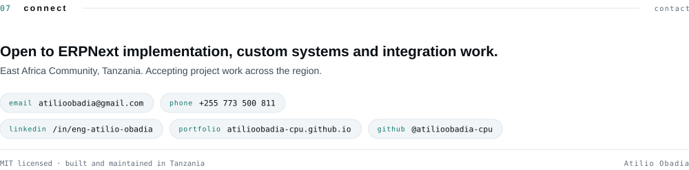

<picture>
  <source media="(prefers-color-scheme: dark)" srcset="assets/dark/header.svg">
  
</picture>

 

<a href="https://atilioobadia-cpu.github.io/profile_personel/"><picture><source media="(prefers-color-scheme: dark)" srcset="https://img.shields.io/badge/portfolio-0d1117?style=flat-square&amp;logo=googlechrome&amp;logoColor=2dd4bf"></picture></a>
<a href="https://www.linkedin.com/in/eng-atilio-obadia"><picture><source media="(prefers-color-scheme: dark)" srcset="https://img.shields.io/badge/linkedin-0d1117?style=flat-square&amp;logo=linkedin&amp;logoColor=2dd4bf"></picture></a>
<a href="mailto:atilioobadia@gmail.com"><picture><source media="(prefers-color-scheme: dark)" srcset="https://img.shields.io/badge/email-0d1117?style=flat-square&amp;logo=gmail&amp;logoColor=2dd4bf"></picture></a>
<a href="https://github.com/atilioobadia-cpu"><picture><source media="(prefers-color-scheme: dark)" srcset="https://img.shields.io/badge/github-0d1117?style=flat-square&amp;logo=github&amp;logoColor=2dd4bf"></picture></a>

  

<picture>
  <source media="(prefers-color-scheme: dark)" srcset="assets/dark/whoami.svg">
  
</picture>

<picture>
  <source media="(prefers-color-scheme: dark)" srcset="assets/dark/capabilities.svg">
  
</picture>

<picture>
  <source media="(prefers-color-scheme: dark)" srcset="assets/dark/work.svg">
  
</picture>

<picture>
  <source media="(prefers-color-scheme: dark)" srcset="assets/dark/activity.svg">
  
</picture>

<picture>
  <source media="(prefers-color-scheme: dark)" srcset="https://github-profile-summary-cards.vercel.app/api/cards/profile-details?username=atilioobadia-cpu&amp;theme=github_dark">
  
</picture>

 

<picture>
  <source media="(prefers-color-scheme: dark)" srcset="https://streak-stats.demolab.com?user=atilioobadia-cpu&amp;theme=github-dark&amp;hide_border=true">
  
</picture>

  

<picture>
  <source media="(prefers-color-scheme: dark)" srcset="assets/dark/toolkit.svg">
  
</picture>

<picture>
  <source media="(prefers-color-scheme: dark)" srcset="assets/dark/process.svg">
  
</picture>

<picture>
  <source media="(prefers-color-scheme: dark)" srcset="assets/dark/connect.svg">
  
</picture>

<a href="docs/PROJECTS.md">all projects</a> · <a href="docs/DOMAINS.md">domains</a> · <a href="docs/COLLAB.md">collaboration</a> · <a href="CONTRIBUTING.md">contributing</a> · <a href="SECURITY.md">security</a> · <a href="LICENSE">MIT</a>

