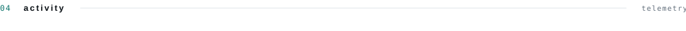

<picture><source media="(prefers-color-scheme: dark)" srcset="assets/dark/header.svg"/></picture>

<a href="https://atilioobadia-cpu.github.io/profile_personel/"><picture><source media="(prefers-color-scheme: dark)" srcset="https://img.shields.io/badge/portfolio-0d1117?style=flat-square&logoColor=ffffff"/></picture></a>
<a href="https://www.linkedin.com/in/eng-atilio-obadia"><picture><source media="(prefers-color-scheme: dark)" srcset="https://img.shields.io/badge/linkedin-0d1117?style=flat-square&logo=linkedin&logoColor=ffffff"/></picture></a>
<a href="mailto:atilioobadia@gmail.com"><picture><source media="(prefers-color-scheme: dark)" srcset="https://img.shields.io/badge/email-0d1117?style=flat-square&logo=gmail&logoColor=ffffff"/></picture></a>
<a href="https://github.com/atilioobadia-cpu"><picture><source media="(prefers-color-scheme: dark)" srcset="https://img.shields.io/badge/github-0d1117?style=flat-square&logo=github&logoColor=ffffff"/></picture></a>

<picture><source media="(prefers-color-scheme: dark)" srcset="assets/dark/s01.svg"/></picture>
<picture><source media="(prefers-color-scheme: dark)" srcset="assets/dark/whoami.svg"/></picture>
<picture><source media="(prefers-color-scheme: dark)" srcset="assets/dark/s02.svg"/></picture>
<picture><source media="(prefers-color-scheme: dark)" srcset="assets/dark/ecosystem.svg"/></picture>
<picture><source media="(prefers-color-scheme: dark)" srcset="assets/dark/s03.svg"/></picture>
<picture><source media="(prefers-color-scheme: dark)" srcset="assets/dark/projects.svg"/></picture>
<picture><source media="(prefers-color-scheme: dark)" srcset="assets/dark/s04.svg"/></picture>
<picture><source media="(prefers-color-scheme: dark)" srcset="assets/dark/telemetry.svg"/></picture>

<picture><source media="(prefers-color-scheme: dark)" srcset="assets/dark/stats.svg"/></picture>

<picture><source media="(prefers-color-scheme: dark)" srcset="assets/dark/activity.svg"/></picture>

<picture><source media="(prefers-color-scheme: dark)" srcset="assets/dark/s05.svg"/></picture>
<picture><source media="(prefers-color-scheme: dark)" srcset="assets/dark/timeline.svg"/></picture>
<picture><source media="(prefers-color-scheme: dark)" srcset="assets/dark/experience.svg"/></picture>
<picture><source media="(prefers-color-scheme: dark)" srcset="assets/dark/s06.svg"/></picture>
<picture><source media="(prefers-color-scheme: dark)" srcset="assets/dark/stack.svg"/></picture>
<picture><source media="(prefers-color-scheme: dark)" srcset="assets/dark/footer.svg"/></picture>

<a href="docs/PROJECTS.md">all projects</a> · <a href="docs/DOMAINS.md">domains</a> · <a href="docs/COLLAB.md">collaboration</a> · <a href="CONTRIBUTING.md">contributing</a> · <a href="SECURITY.md">security</a> · <a href="LICENSE">MIT</a>

