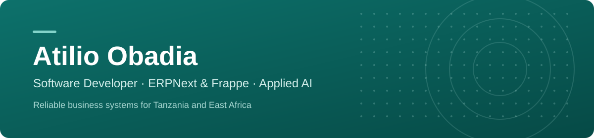

  
    
  
  
  

## About

I build practical business software, integrations, and AI tools, with a focus on reliable ERP systems for organisations in Tanzania and East Africa. Based in Dar es Salaam.

- **ERPNext & Frappe:** implementation, customisation, and country-specific development
- **Financial software:** systems for SACCOs and microfinance institutions
- **Integrations:** APIs, payment gateways, and biometric devices
- **Applied AI:** assistants that automate business workflows

## Selected work

| [AIMS CAMS](https://github.com/atilioobadia-cpu/aimscams) | [Tanzania ERPNext Localisation](https://github.com/atilioobadia-cpu/csf_tanzania_v16) | [AIMS AI Agent](https://github.com/atilioobadia-cpu/AIMS_Ai_Agent) |
|:--|:--|:--|
| Financial software for SACCOs and microfinance institutions. | Country-specific ERPNext and Frappe development. | An AI assistant for business workflows in ERPNext. |

## Tech

## Let's work together

I'm open to collaboration on ERPNext projects, system integrations, and AI-powered tools.

[More projects](docs/PROJECTS.md) · [Get in touch](mailto:atilioobadia@gmail.com)
